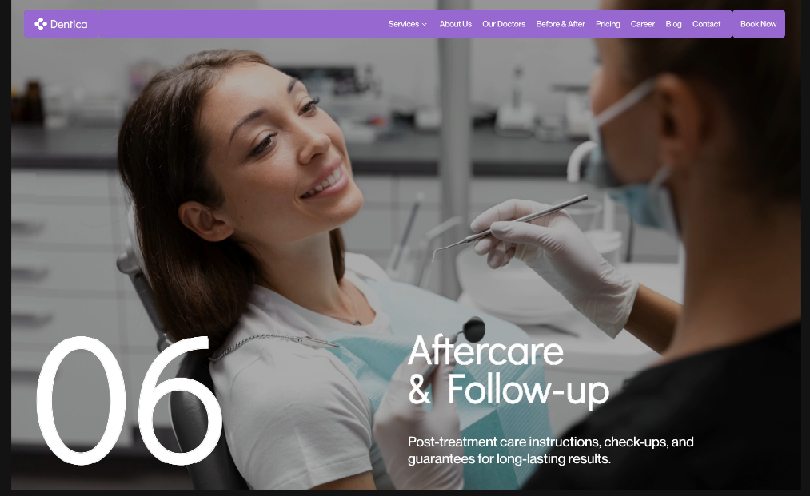

## 04 · Dentica – pasos con paneles pinned (aportada por el usuario)
(sin URL, captura del usuario) · 
- Tomar: sección pinned a pantalla completa; al hacer scroll el panel cambia de paso (foto full-bleed con overlay oscuro, número gigante "06" abajo a la izquierda, título + descripción corta abajo a la derecha); un paso por viewport
- Evitar: nav sobre la foto compitiendo con el contenido del paso
