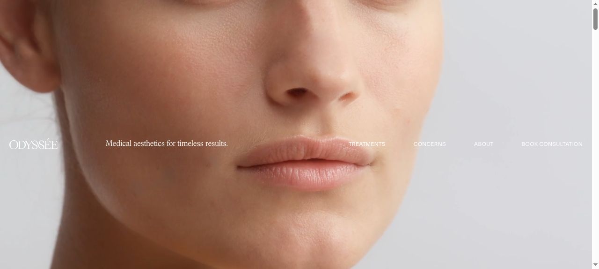
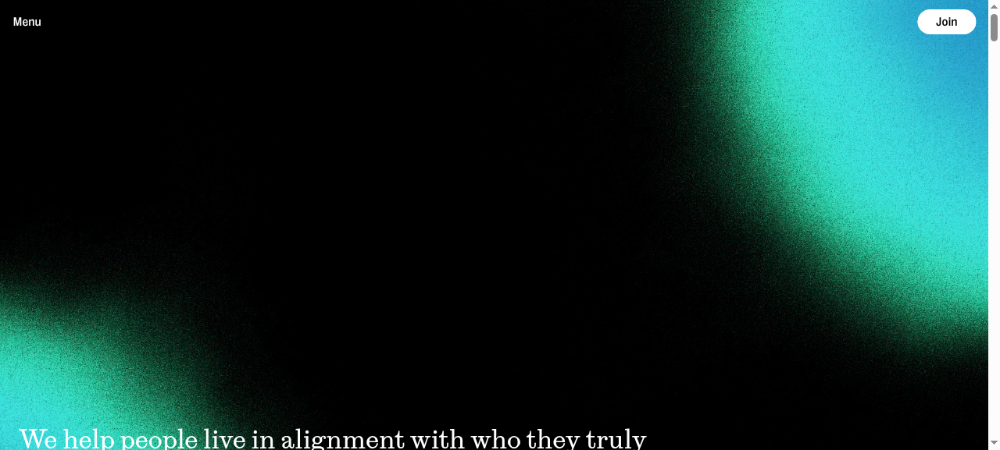
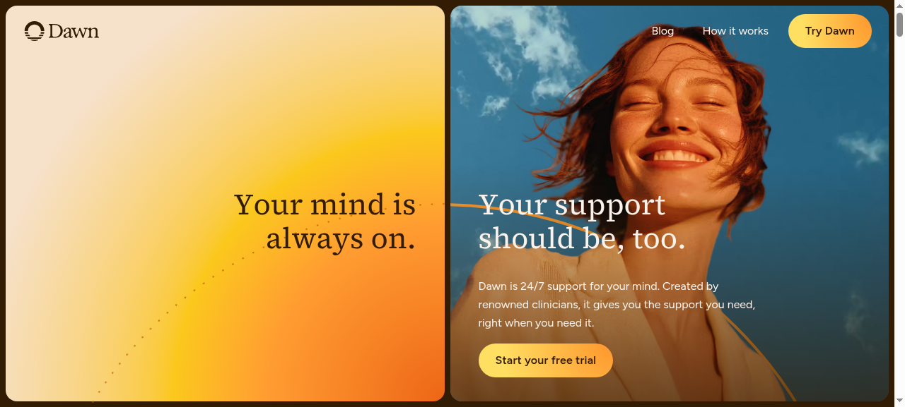
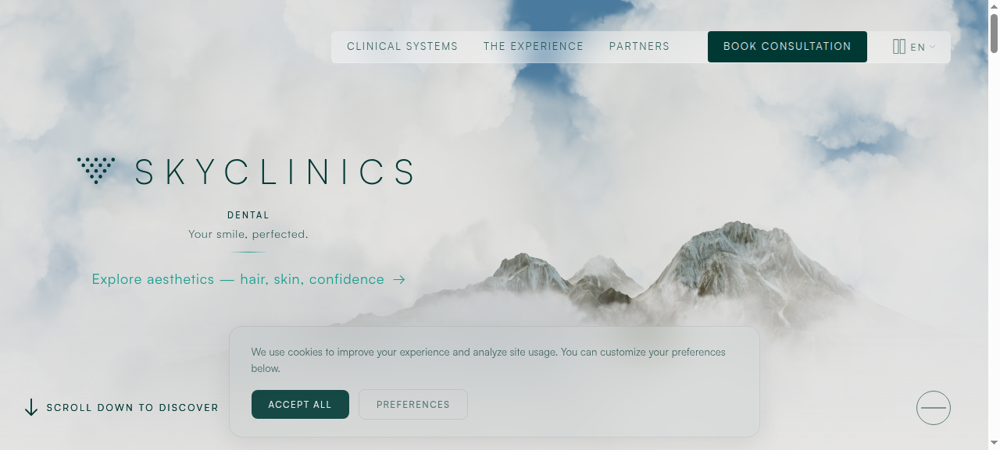
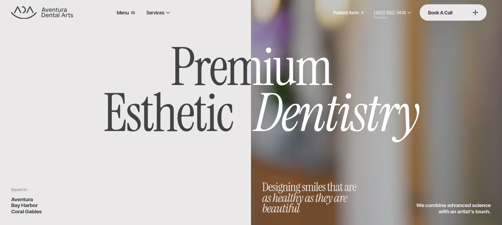
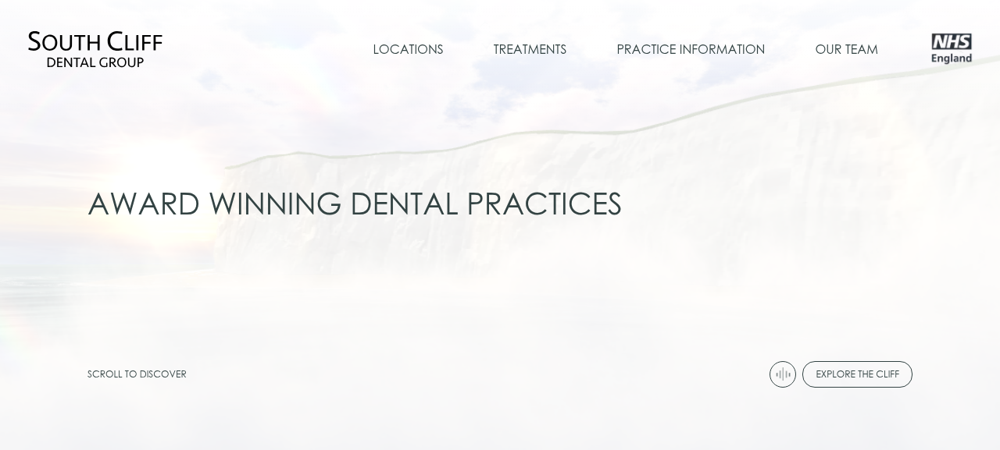

## 01 · Odyssée
https://odysseeclinic.com.au · 
- Tomar: hero a pantalla completa con primer plano sereno, serif fina en lema y logo, navegación mínima en mayúsculas
- Evitar: texto blanco sobre foto clara (contraste bajo); en el sitio usar texto carbón sobre marfil

## 02 · ONOERA
https://onoera.com · 
- Tomar: serif grande y aireada, brillo difuso turquesa con grano como acento, navegación casi vacía
- Evitar: fondo negro (la paleta es marfil); llevar el degradado turquesa como halo suave sobre marfil

## 03 · Dawn
https://joindawn.com · 
- Tomar: hero dividido en dos paneles redondeados (texto/foto), serif cálida en el titular, sonrisa humana como foto
- Evitar: naranja saturado y botón con degradado; botón en turquesa liso

## 04 · Sky Clinics
https://skyclinics.al · 
- Tomar: hero luminoso y etéreo, tipografía ligera con mucho aire, menú en pastilla translúcida con CTA oscuro a la derecha
- Evitar: banner de cookies sobre el hero; tono verde bosque del CTA (usar turquesa oscuro)

## 05 · Aventura Dental Arts
https://aventuradentalarts.com · 
- Tomar: hero partido 50/50 (marfil / foto), titular serif condensada con una palabra en cursiva que cruza ambos paneles, CTA en pastilla blanca
- Evitar: texto blanco sobre la foto borrosa (contraste bajo); usar carbón

## 06 · South Cliff Dental Group
https://southcliffdentalgroup.com · 
- Tomar: fondo casi blanco con niebla suave, titular fino en mayúsculas, enlace secundario en botón de contorno
- Evitar: contraste débil del titular y la foto desvaída; reforzar con carbón sobre marfil
